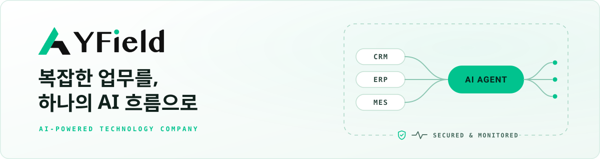
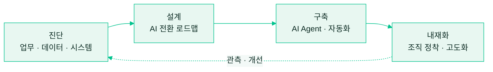

<a href="https://yfield.co.kr">
  <picture>
    <source media="(prefers-color-scheme: dark)" srcset="https://raw.githubusercontent.com/yfield-inc/.github/main/profile/assets/banner-dark.svg">
    <source media="(prefers-color-scheme: light)" srcset="https://raw.githubusercontent.com/yfield-inc/.github/main/profile/assets/banner-light.svg">
    
  </picture>
</a>

 

   

---

## 와이필드는

**Agentic AI** 기술로 기업의 데이터와 시스템을 이해하고, **업무가 실제로 실행되는 구조**를 설계하고 구축합니다.

AI를 도입하는 일은 모델을 고르는 일이 아니라, 흩어진 시스템과 사람의 일 사이에 흐름을 놓는 일이라고 봅니다. 그래서 진단부터 내재화까지를 하나의 과정으로 다룹니다.

 

## 무엇을 하나요

<table>
<tr>
<td width="33%" valign="top">

### CX 자동화

AI Agent가 고객 문의에 응대하고,
흩어진 문의·리뷰를 모아
**개선 우선순위**까지 제안합니다.

</td>
<td width="33%" valign="top">

### Enterprise AX

CRM · ERP · MES를 잇고
업무에 맞는 AI Agent를 세워
**의사결정을 자동화**합니다.

</td>
<td width="33%" valign="top">

### 제조 · ESG AX

제조 현장의 데이터와
ESG 지표를 연결해
**측정 가능한 운영**으로 바꿉니다.

</td>
</tr>
</table>

 

## 어떻게 일하나요

마지막 단계가 끝이 아닙니다. 운영에서 관측한 것이 다시 다음 진단의 입력이 됩니다.

 

## 보안과 모니터링

> **지켜야 할 것은 경계선이 아니라, 지금 시스템에서 벌어지는 일입니다.**

완벽한 예방을 약속하지 않습니다. 대신 **얼마나 빨리 발견하고, 얼마나 빨리 되돌릴 수 있는가**를 기준으로 시스템을 설계합니다. 침해가 피해로 번지는 거리는 거의 언제나 '인지까지 걸린 시간'이기 때문입니다.

- **관측을 먼저 세웁니다** — 기능보다 로그 · 메트릭 · 트레이스가 먼저입니다. 무엇이 정상인지 모르면, 무엇이 이상한지도 알 수 없습니다.
- **대응은 패치에서 끝내지 않습니다** — 막아낸 공격도 로그를 되짚어 공격자의 행동 패턴을 파악하고, 추가 보안 패치까지 배포합니다.
- **고칠 수 있는 구조로 만듭니다** — 취약점보다 위험한 것은, 발견하고도 신속하게 고칠 수 없는 환경입니다. 의존성과 배포 경로를 단순하게 유지합니다.

📝 **관련 글** · [보안, 이제는 방어보다 모니터링이다](https://yfield.co.kr/blog/boan-ijeneun-bangeoboda-moniteoringida) · [해킹 시도는 막았지만, 대응은 거기서 끝나지 않았다](https://yfield.co.kr/blog/haeking-sidoneun-magassjiman-daeeungeun-geogiseo-ggeutnaji-anhassda) · [Java4Shell, 왜 위험한가요?](https://yfield.co.kr/blog/java4shell-wae-wiheomhangayo) · [Grafana Faro로 프론트엔드 모니터링하기](https://yfield.co.kr/blog/grafana-faroro-react-typescript-peuronteuendeu-moniteoringhagi)

 

## 기술

          

### 눈여겨보는 오픈소스

실제 프로젝트는 대부분 고객사 계약에 따라 **비공개 저장소**에서 운영합니다.
공개 저장소에는 우리가 추적하고 검증하는 오픈소스를 포크해 둡니다.

| 저장소 | 분야 |
| --- | --- |
| [grafana](https://github.com/yfield-inc/grafana) | 관측 가능성 — 메트릭 · 로그 · 트레이스 |
| [vaultwarden](https://github.com/yfield-inc/vaultwarden) | 시크릿 · 자격증명 관리 |
| [n8n](https://github.com/yfield-inc/n8n) | 워크플로 자동화 |
| [genkit](https://github.com/yfield-inc/genkit) | AI 애플리케이션 프레임워크 |
| [pgvector](https://github.com/yfield-inc/pgvector) | Postgres 벡터 검색 |
| [fanuc_driver](https://github.com/yfield-inc/fanuc_driver) | FANUC 로봇 ROS 2 연동 — 제조 AX |

 

## 함께 하기

도입을 검토 중이시라면, 현재 업무가 어떻게 흐르고 있는지부터 같이 보겠습니다.

### [무료 상담 신청 →](https://yfield.co.kr)

**contact@yfield.co.kr** · 070-4348-5020
경기도 안양시 동안구 엘에스로 142, 819호

 

와이필드 주식회사 · YField Inc.

